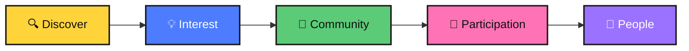
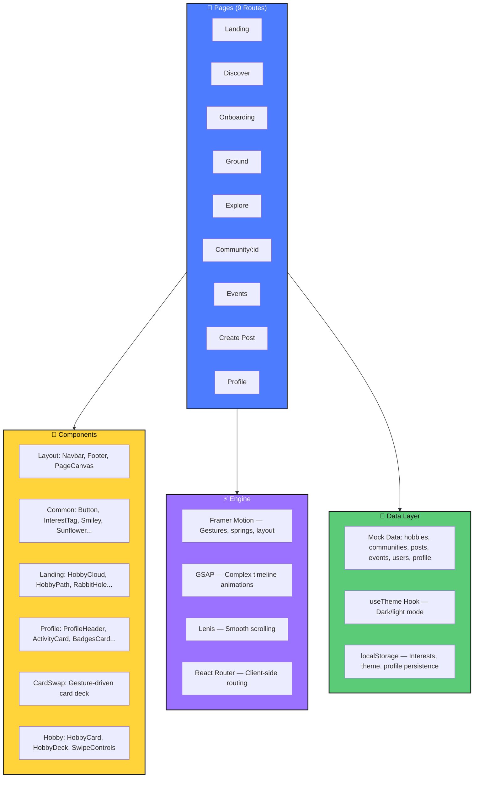
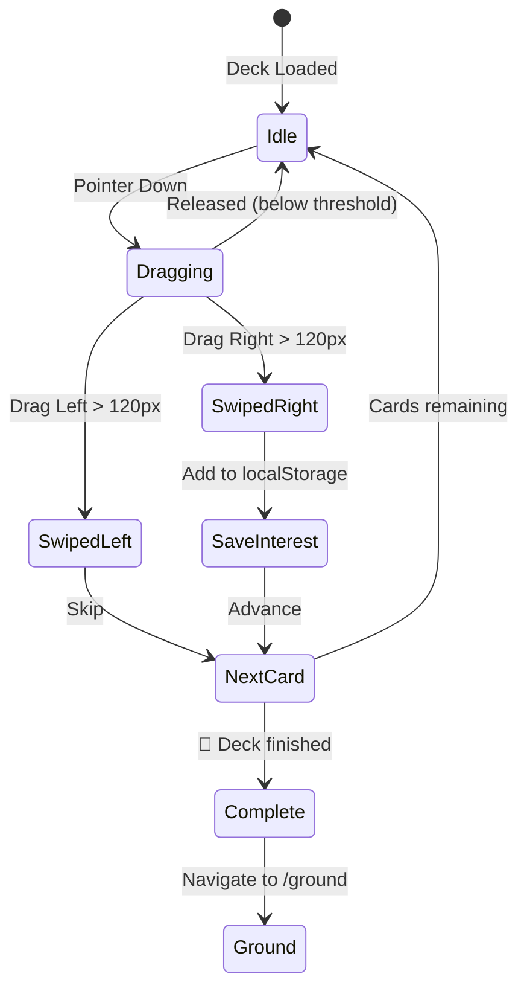
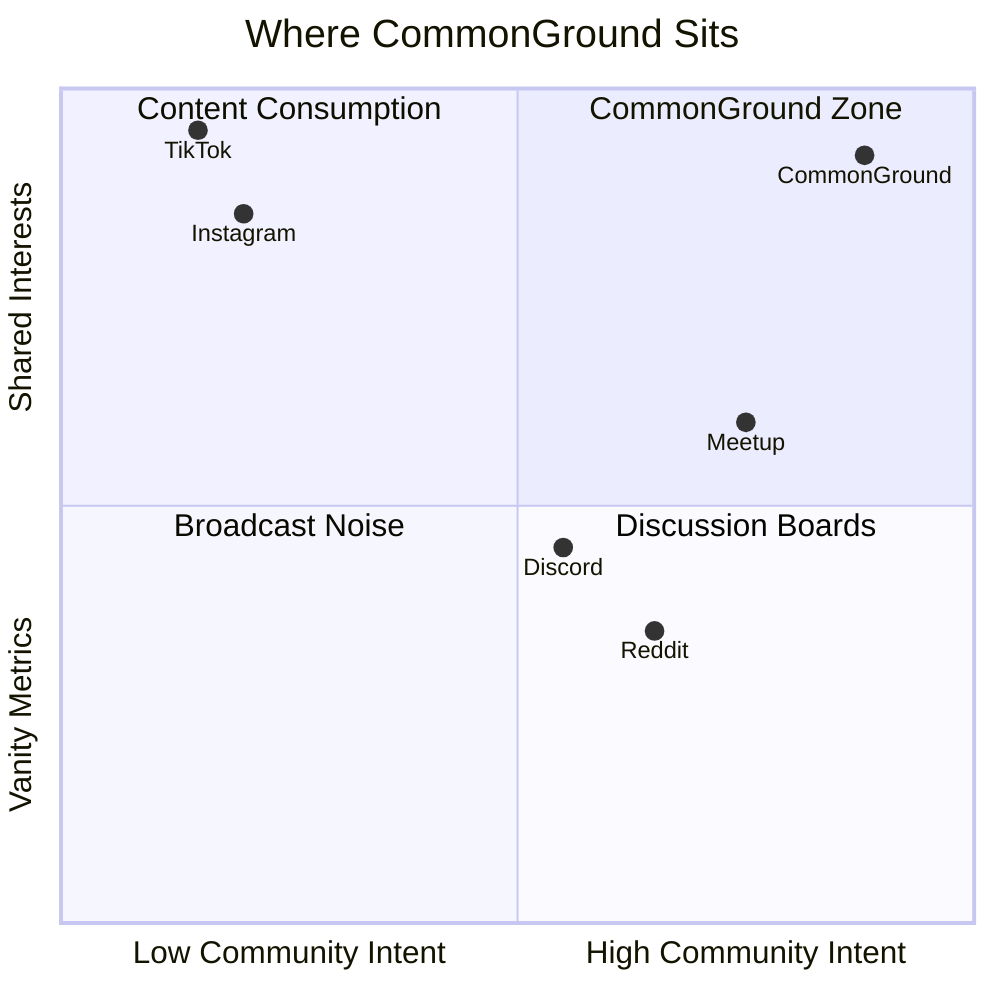

<div align="center">

# 🌻 CommonGround

### *Find your people, not just hobbies.*

[](https://react.dev)
[](https://vite.dev)
[](https://www.framer.com/motion/)
[](LICENSE)

**A hobby discovery and community platform for college students and young adults.**

Not a social network. Not an infinite feed.
The place you walk into when you think — *"I want to try something new."*

[🚀 Live Demo](#) · [📖 Documentation](#-design-philosophy) · [⚡ Quick Start](#-quick-start)

---

</div>

## 🧭 The Core Loop

> Every feature in CommonGround supports one journey:



```
"I don't know what I'm interested in."
         ↓
"I found something interesting."
         ↓
"Oh, other people like this too."
         ↓
"These people are doing interesting things."
         ↓
"I want to participate."
```

---

## 🗺️ Pages & Routes

CommonGround has **9 fully-built pages**, each with its own responsive CSS:

| Route | Page | What It Does |
|:------|:-----|:-------------|
| `/` | **Landing** | Hero with interactive sunflower mascot, animated checkerboard, hobby cloud, text loop ribbon, community showcase |
| `/discover` | **Discover** | Full-screen "Hobby Tinder" — swipe right to save, left to skip. Spring physics, rotation, stacked cards |
| `/onboarding` | **Onboarding** | Step-by-step guided hobby selection with the Stepper component |
| `/ground` | **Ground** | Personalized home feed — your interests, trending communities, discussions, vibe check, people to follow |
| `/explore` | **Explore** | Browse all hobbies by category with accordion gallery and depth carousel |
| `/community/:id` | **Community** | Full community hub — posts, discussions, members, related interests |
| `/events` | **Events** | Browse, filter, and RSVP to upcoming workshops, meetups, and online events |
| `/create` | **Create Post** | Rich post creation — discussions, questions, ideas, projects with image uploads and tags |
| `/profile` | **Profile** | User profile with about, hobbies, activity feed, badges, achievements, connections |

---

## ✨ Key Features

<table>
<tr>
<td width="50%">

### 🃏 Hobby Swipe Deck
Tinder-style card swiping with drag gestures, spring physics, rotation based on drag direction, and stacked-card reveals.

### 🌻 Living Sunflower Mascot
SVG character with cursor-tracking eyes (spring-based), random idle blinking, click reactions, and button awareness.

### ♟️ Interactive Checkerboard
240 DOM tiles that react to cursor proximity — tiles push away, flash accent colours, and smoothly transition via `requestAnimationFrame`.

</td>
<td width="50%">

### 🌓 Dark / Light Mode
Full theme support via `[data-theme]` attribute with CSS custom properties. Persisted in `localStorage`. Smooth transitions.

### 📱 Fully Responsive
10+ breakpoints from 1440px → 360px. Mobile-first bottom dock nav. Adaptive grids, hidden decorative elements on small screens.

### 🎭 Hand-Drawn Personality
Doodles, sketch arrows, sunflowers, smileys, and a Caveat handwritten font layer — all on top of a Swiss-clean grid structure.

</td>
</tr>
</table>

---

## 🎨 Design Philosophy

> **"Keep the structure Swiss-clean. Make the personality hand-drawn."**

```
BLACK AND WHITE CREATE THE WORLD.
COLOR MARKS WHAT MATTERS.
IMPERFECTION MAKES IT HUMAN.
```

### Color System

```
 Light Mode                              Dark Mode
 ─────────────────────────────           ─────────────────────────────
 Background   #F7F6F2  ░░░░░░           Background   #0D0D0D  ██████
 Surface      #FFFFFF  ░░░░░░           Surface      #171717  ██████
 Text         #111111  ██████           Text         #F7F6F2  ░░░░░░
 Muted        #6F6F6A  ▓▓▓▓▓▓           Muted        #A6A49D  ▓▓▓▓▓▓
 Border       #191919  ██████           Border       #F7F6F2  ░░░░░░
```

### Accent Palette (~10–15% of the UI)

```
 Yellow  ■ #FFD43B    Blue  ■ #4D7CFE    Pink    ■ #FF72B6
 Red     ■ #FF5C5C    Green ■ #5BCB77    Orange  ■ #FF914D
 Purple  ■ #9B72FF
```

### Visual Motifs

| Motif | Meaning | Used In |
|:------|:--------|:--------|
| ♟️ **Chessboard** | Common ground — different things meeting | Hero backgrounds, section headers, page canvases |
| 🌻 **Sunflower** | Discovery & growth | Mascot, onboarding completion, navbar, community joins |
| 😊 **Smileys** | Human warmth | Empty states, success moments, reactions |
| ✏️ **Doodles** | Playful imperfection | Sketch arrows, hand-drawn shapes, annotations |

---

## 🏗️ Architecture



---

## 📁 Project Structure

```
common-ground/
├── index.html                      # Entry HTML — meta, fonts, favicon
├── package.json                    # Dependencies & scripts
├── vite.config.js                  # Vite build config
│
└── src/
    ├── main.jsx                    # React DOM entry point
    ├── App.jsx                     # BrowserRouter + Routes + AnimatePresence
    ├── index.css                   # 🎨 Global design tokens & CSS reset
    │
    ├── animations/
    │   └── variants.js             # Shared Framer Motion presets
    │                                 (pageVariants, staggerContainer,
    │                                  cardHover, buttonTap, swipeCardVariants,
    │                                  bloomVariants, drawPath...)
    │
    ├── components/
    │   ├── CardSwap/
    │   │   ├── CardSwap.jsx        # Full-screen gesture-driven card deck
    │   │   └── CardSwap.css
    │   │
    │   ├── common/                 # ♻️ Reusable across pages
    │   │   ├── AccordionGallery/   # Expandable image gallery
    │   │   ├── Button.jsx          # Primary / Secondary / Ghost variants
    │   │   ├── ChessPattern.jsx    # ♟️ Checkerboard SVG background
    │   │   ├── DepthCarousel.jsx   # 3D perspective carousel
    │   │   ├── DoodleDaisy.jsx     # Hand-drawn daisy illustration
    │   │   ├── FlowingMenu.jsx     # Dynamic interactive menu
    │   │   ├── InteractiveCheckerboard.jsx  # 🎮 Cursor-reactive tile grid
    │   │   ├── InterestTag.jsx     # Colored pill tags with emoji
    │   │   ├── ScrollStack.jsx     # Scroll-driven stack effect
    │   │   ├── SketchArrow.jsx     # SVG hand-drawn arrows
    │   │   ├── Smiley.jsx          # 😊 Expressive face illustrations
    │   │   ├── Stepper.jsx         # Multi-step progress component
    │   │   ├── Sunflower.jsx       # 🌻 Static blooming sunflower
    │   │   ├── SunflowerGroup.jsx  # Companion sunflower field
    │   │   ├── SunflowerMascot.jsx # 👀 Eye-tracking interactive mascot
    │   │   └── TextLoop.jsx        # GSAP-powered marquee text ribbon
    │   │
    │   ├── hobby/                  # Onboarding deck components
    │   │   ├── HobbyCard.jsx       # Individual swipeable card
    │   │   ├── HobbyDeck.jsx       # Stack physics + gesture handler
    │   │   └── SwipeControls.jsx   # Pass / Interested buttons
    │   │
    │   ├── landing/                # Landing page sections
    │   │   ├── CommonGroundMerge.jsx    # Visual interest merging
    │   │   ├── CommonGroundMerger.jsx   # Animated merge graphic
    │   │   ├── CommunityFloat.jsx      # Floating community cards
    │   │   ├── FinalCTA.jsx            # Call-to-action banner
    │   │   ├── HobbyCardStack.jsx      # Card stack preview
    │   │   ├── HobbyCloud.jsx          # Floating hobby pill cloud
    │   │   ├── HobbyPath.jsx           # Illustrated journey path
    │   │   ├── LandingJourney.jsx      # Step progression visual
    │   │   ├── RabbitHole.jsx          # Deep-dive discovery section
    │   │   └── SurpriseMe.jsx          # Random hobby generator
    │   │
    │   ├── layout/                 # App shell
    │   │   ├── Navbar.jsx          # Floating bottom dock + theme toggle
    │   │   ├── BottomNav.jsx       # Mobile bottom navigation
    │   │   ├── Footer.jsx          # Storybook-style footer with parallax
    │   │   └── PageCanvas.jsx      # Responsive page wrapper (<main>)
    │   │
    │   └── profile/                # Profile sub-components
    │       ├── ProfileHeader.jsx       # Avatar, name, bio, edit mode
    │       ├── ProfileStats.jsx        # Interest stats & visualizations
    │       ├── ProfileTabs.jsx         # Tab switcher (About/Activity)
    │       ├── AboutCard.jsx           # Bio & details card
    │       ├── HobbiesCard.jsx         # Hobby collection display
    │       ├── ActivityCard.jsx        # Activity feed timeline
    │       ├── BadgesCard.jsx          # Achievement badges
    │       ├── AchievementsCard.jsx    # Milestone tracker
    │       ├── ConnectionsCard.jsx     # People connections
    │       ├── ShareVibeCard.jsx       # Share your vibe CTA
    │       ├── ProfileCompletionCard.jsx # Profile progress
    │       └── JourneySteps.jsx        # Visual journey progression
    │
    ├── data/                       # 📊 Mock database
    │   ├── hobbies.js              # 20 hobbies across 11 categories
    │   ├── communities.js          # Community hubs with metadata
    │   ├── posts.js                # Discussion threads & showcases
    │   ├── events.js               # Workshops, meetups, online events
    │   ├── users.js                # Student profiles
    │   └── profileData.js          # User profile seed data
    │
    ├── hooks/
    │   └── useTheme.js             # Custom hook: theme + localStorage + DOM sync
    │
    └── pages/                      # 📄 Top-level route views
        ├── Landing.jsx / .css      # Front door — hero, checkerboard, mascot
        ├── Discover.jsx / .css     # Hobby Tinder full-screen swiping
        ├── Onboarding.jsx / .css   # Guided hobby selection stepper
        ├── Ground.jsx / .css       # Personalized feed & interest hub
        ├── Explore.jsx / .css      # Category browsing & discovery
        ├── Community.jsx / .css    # Community hub with posts & members
        ├── Events.jsx / .css       # Event listing, filtering & RSVP
        ├── CreatePost.jsx / .css   # Rich post/thread creation
        └── Profile.jsx / .css      # User profile with tabs & cards
```

---

## 🔧 Tech Stack

| Layer | Technology | Version | Purpose |
|:------|:-----------|:--------|:--------|
| **Framework** | React | 19.2 | UI components & state management |
| **Build Tool** | Vite | 8.2 | Lightning-fast HMR & bundling |
| **Routing** | React Router | 7.18 | Client-side navigation with dynamic routes |
| **Animation** | Framer Motion | 13.0 | Gesture physics, springs, layout animations |
| **Animation** | GSAP | 3.15 | Complex timeline animations (TextLoop) |
| **Scrolling** | Lenis | 1.3 | Smooth scroll on desktop views |
| **Icons** | Lucide React | 1.28 | Clean, consistent icon set |
| **Fonts** | Inter + Caveat | — | Swiss typography + hand-drawn accents |
| **Backend** | Supabase | 2.118 | Postgres, magic-link auth, storage |
| **Linting** | oxlint | 1.75 | Fast Rust-based linter |

---

## 🔄 Hobby Swipe — State Machine



---

## ⚖️ How We're Different



| | Instagram | Reddit | Discord | **CommonGround** |
|:--|:----------|:-------|:--------|:-----------------|
| Core unit | Post | Thread | Chat | **Interest** |
| Discovery | Algorithm | Subreddits | Servers | **Hobby swiping** |
| Identity | Followers | Karma | Roles | **What you enjoy** |
| Goal | Engagement | Discussion | Conversation | **Participation → People** |

---

## 📊 Hobby Categories

```
Creative      ████████████████████  7   Photography, Pottery, Film, Drawing,
                                        Writing, Fashion, Calligraphy
Fitness       █████████             3   Running, Bouldering, Cycling
Lifestyle     ██████                2   Cooking, Gardening
Music         ████                  1   Guitar
Tech          ████                  1   AI & Machine Learning
Performance   ████                  1   Dance
Strategy      ████                  1   Chess
Entertainment ████                  1   Gaming
Making        ████                  1   Woodworking
Science       ████                  1   Astronomy
Sports        ████                  1   Skateboarding
─────────────────────────────────────────────
Total                              20   hobbies across 11 categories
```

---

## ⚡ Quick Start

```bash
# Clone
git clone https://github.com/KhushiBagga20/Common-Ground.git
cd Common-Ground

# Install
npm install

# Dev server (localhost:5173)
npm run dev

# Production build
npm run build

# Preview production build
npm run preview

# Lint
npm run lint
```

---

## 🗄️ Backend (Supabase)

The app runs in **demo mode** out of the box: sample data, with your joins, likes, RSVPs and posts kept in this browser. Connect Supabase to get real accounts and shared data.

1. **Create a project** at [supabase.com](https://supabase.com).
2. **Create the tables.** In the dashboard's SQL Editor, run [`supabase/migrations/20261026120000_init.sql`](supabase/migrations/20261026120000_init.sql), then [`supabase/seed.sql`](supabase/seed.sql). If you use the Supabase CLI, `supabase db push` and `supabase db reset` do the same.
3. **Allow the sign-in redirect.** Under Authentication → URL Configuration, add `http://localhost:5173/**` (and your deployed URL) to Redirect URLs. Email magic links are on by default.
4. **Add your keys.** Copy `.env.example` to `.env.local` and fill in the project URL and anon key from Project Settings → API. Restart `npm run dev`.

| What | Where it lives |
|:-----|:---------------|
| Hobbies, communities, events, posts | public tables, readable by anyone |
| Your profile, interests and activity | `profiles` (one row per account, created on sign-up) |
| Joins, likes, RSVPs | `community_members`, `post_likes`, `event_rsvps` — only you can see or change yours |
| Post images | the public `post-media` Storage bucket, under your user id |

Member, like and interested counts are kept by database triggers. Row-level security means people can only write their own rows.

If you edit the sample data in `src/data`, regenerate the seed with `npm run db:seed-sql`.

---

## 👥 Team

Built by a 4-person team as a frontend prototype over ~12 days.

---

<div align="center">

### 🌻 ♟️ 😊

**CommonGround** — *Find your people, not just hobbies.*

*The structure is Swiss-clean. The personality is hand-drawn.*

</div>
